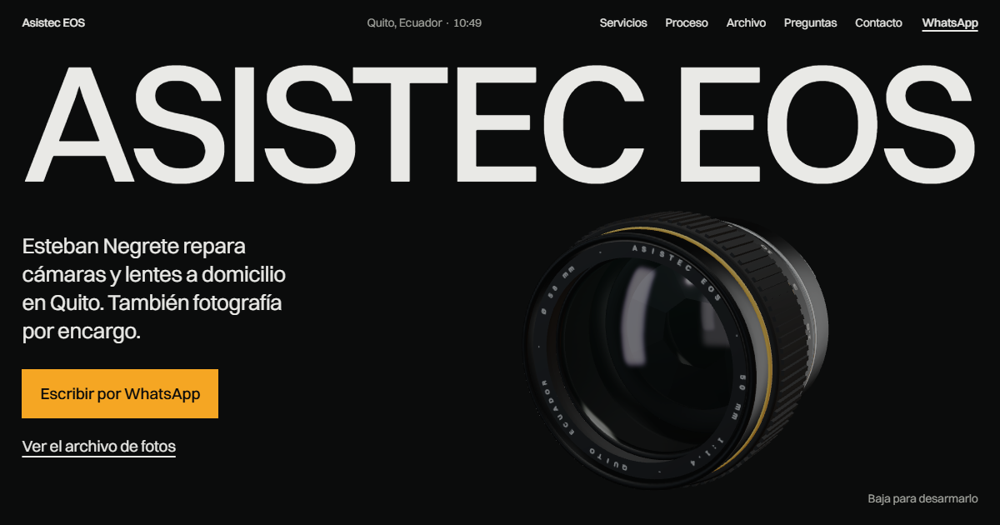

# Asistec EOS — landing de reparación de cámaras y fotografía (Quito)

Landing page para **Esteban Negrete**, técnico que repara cámaras y lentes a domicilio en Quito (sin local físico) y que además trabaja como fotógrafo.

> **Rama `taller`:** versión nueva, solo del taller de reparación (sin fotografía), con capítulos numerados y una vitrina de fallas sobre el lente 3D. La demo original vive en la rama `master`.

**Demo en vivo (rama `master`):** https://asistec-eos.vercel.app

> **Estado: demo para presentar al cliente.** Teléfono, RUC, horario, servicios, respuestas de preguntas frecuentes y fotografías son datos de muestra marcados con `TODO: dato real` en el código. Está publicada como demo, sin indexar en buscadores.



## Qué problema resuelve

Esteban no tiene mostrador: sus clientes lo encuentran por recomendación y por WhatsApp. La página le da una presencia profesional que explica cómo trabaja (retiro, diagnóstico, presupuesto, reparación y entrega), muestra su trabajo fotográfico y lleva cada consulta directo a WhatsApp con el mensaje ya escrito.

## Qué tiene

- **Hero 3D**: un lente construido por código con three.js (sin modelos externos) que se desarma pieza por pieza al hacer scroll y vuelve a armarse.
- **Archivo fotográfico**: mosaico disperso con huecos, desenfoque del resto al pasar el cursor y visor a pantalla completa con teclado.
- **Servicios como enlaces**: cada servicio abre WhatsApp con un mensaje específico.
- **Contacto sin backend**: el formulario arma el mensaje en el navegador y abre WhatsApp; la página no guarda datos personales.

## Tecnologías

HTML, CSS y JavaScript sin framework ni paso de compilación. three.js r170 servido desde el propio sitio (`vendor/`). Despliegue previsto en Vercel.

## Decisiones técnicas

- **Rendimiento**: three.js se carga con `import()` después del evento `load`, así el texto y el botón de WhatsApp aparecen sin esperar al 3D. El lente deja de renderizar cuando sale de pantalla. Imágenes WebP con `width`/`height` y `loading="lazy"`.
- **Seguridad**: cabeceras en `vercel.json` (CSP sin `unsafe-inline`, HSTS, `nosniff`, `frame-ancestors 'none'`, `Referrer-Policy`, `Permissions-Policy`). Sin scripts de terceros. Los textos del usuario se codifican con `encodeURIComponent` y nunca se insertan como HTML. Honeypot en el formulario.
- **Privacidad (LOPDP)**: no hay cookies, analítica ni almacenamiento de datos; la política de privacidad lo explica y lista los derechos del titular.
- **SEO local**: `lang="es-EC"`, JSON-LD `LocalBusiness`, Open Graph para compartir en WhatsApp.
- **Accesibilidad**: navegación por teclado, foco visible, `prefers-reduced-motion` respetado (el lente queda estático y el contenido aparece sin animación), contraste AA.

## Ejecutar en local

```bash
npx serve .
```

Los módulos de JavaScript necesitan un servidor; abrir `index.html` con doble clic no carga el 3D.

## Pendiente antes de publicar

Buscar `TODO: dato real` en el proyecto: número de WhatsApp, RUC, horario, cobertura, servicios, respuestas, Instagram, dominio y las fotos de Esteban (las actuales son de muestra, de picsum.photos con licencia Unsplash).

## Autor

Joel — estudiante de Ingeniería en Sistemas de la Información, PUCE (Quito).
